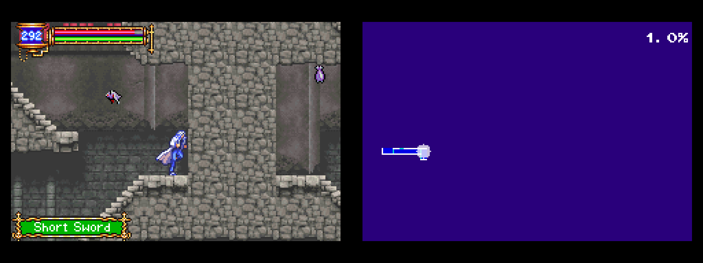
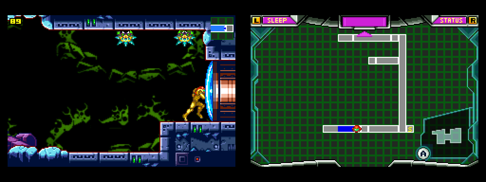

# gbadual

A Game Boy Advance emulator for dual-screen handhelds (built for the Anbernic RG DS Plus on ROCKNIX). The game runs on one screen, and the game's own map stays up on the other screen and keeps itself current as you explore, the way the DS Castlevanias work.




| Game | Map button | Status |
|---|---|---|
| Castlevania: Aria of Sorrow (USA) | Select | working |
| Castlevania: Harmony of Dissonance (USA) | Select | working |
| Castlevania: Circle of the Moon (USA) | Select | working |
| Metroid: Zero Mission (USA) | Start | working |
| Metroid Fusion (USA) | Start | working |

Any other GBA game also runs; it just gets no map screen.

## How it works

Emulation is [libmgba](https://mgba.io). gbadual runs a second, silent copy of the emulator next to the real one. About every 1.5 seconds, and right after each room transition (detected as a fade to black), it does the following:

1. It copies the live game's state into the silent copy. The game you're playing is never paused or touched.
2. It presses the map button there, waits for the map screen to appear and settle, then records a short loop of frames so the blinking or pulsing player marker still animates.
3. It checks the result two ways before showing it: a memory flag that is set only while the map screen is open, and fixed pixels of the map screen's frame or background. Title screens, cutscenes, menus, and fades are rejected, and the previous map stays up.

You see the real in-game map with every detail the game draws (explored rooms, save and warp rooms, completion %, area names) at 4× integer scale.

## Install on ROCKNIX

1. Unzip `gbadual-rocknix-aarch64.zip` into `/storage/roms/ports/`. You'll get a `gbadual/` folder and a **GBA Dual Screen** entry.
2. Keep your **unzipped** `.gba` ROMs in `/storage/roms/gba/` (subfolders are fine). Zipped ROMs aren't supported yet.
3. In EmulationStation, update the game lists and launch **GBA Dual Screen** from Ports.

The app opens on a game list:
- The list is rebuilt from the ROM folder every time it opens, so games you add or remove show up with nothing to re-run.
- Only games with map support are listed. Set `show_all = 1` to list every `.gba`; games without map support play normally on one screen.
- The top screen shows the game's logo, or where it will resume once you've played it.

If you used the earlier build, delete the old `... (Dual Screen).sh` entries from `/storage/roms/ports/`.

## Playing

- **Resume:** leaving a game saves its state automatically, and launching it again picks up exactly there. Turn this off with `auto_resume = 0`. Battery saves are written as usual too, so in-game saves are never at risk.
- **Pause menu:** tap the touchscreen or press **HOME**. Both screens dim, the game and its sound pause, and the menu appears on the touchscreen:
  - Resume
  - Swap screens
  - Scale: pixel perfect (4×) or full width (fills the screen width, keeps the shape)
  - LCD grid on or off

  Swap, scale and LCD grid choices are remembered for next time.
  - Save state
  - Load state (greyed out until you've saved one)
  - Exit to emulator (saves a resume point, then back to gbadual's game list)
  - Exit to main menu (saves a resume point, then quits to EmulationStation)

  The menu works by touch or with the D-pad and A. B, Start or HOME closes it.

### Buttons

| Button | Action |
|---|---|
| D-pad / left stick | D-pad |
| Right face button | GBA A (`ab_swap = 1` flips A/B) |
| Bottom face button | GBA B |
| L1 / R1 | GBA L / R |
| Start / Select | Start / Select |
| HOME, or tap the touchscreen | Pause menu |
| L2 | Swap screens |
| R2 (hold) | Fast-forward |
| HOME + R1 / L1 | Quick save / load state |
| HOME + Start | Quit |
| HOME + X | FPS counter |

### Library

| Input | Action |
|---|---|
| D-pad, L/R | Move, page up/down |
| A / Start, or tap a game | Play |
| Drag | Scroll the list |
| B, HOME, or QUIT | Back to EmulationStation |

### Where files go

| File | Location |
|---|---|
| Battery saves | `Game.sav`, next to the ROM. On first launch an existing RetroArch `Game.srm` is copied to `Game.sav`; the `.srm` is left alone. |
| Save states, resume points, library thumbnails | `/storage/roms/ports/gbadual/states/` |

Until the first map is ready (title screen, intro, a fresh boot), the map screen shows the game's logo. Logos are `gbadual/logos/<GAME CODE>.bmp`, for example `A2CE.bmp` for Aria of Sorrow. Replace them with any BMP.

## Settings

Settings live in `gbadual.cfg` next to the binary. The file is commented. The options you're most likely to change:

- `rom_dir`: folders to list. Separate several with `:`.
- `swap = 1`: map on the other screen. Swapping from the menu or with L2 is saved to `states/prefs.cfg` and wins over this setting.
- `touch_screen`: `first` or `second`, whichever screen has the touch panel. The menu and game list are drawn there.
- `touch_map`: try `touch_map = screen` if taps land in the wrong place.
- `home_button`: use this if HOME doesn't open the menu.
  1. Start once with `GBADUAL_DEBUG=1` in `launch.sh`.
  2. Press HOME.
  3. Put the button number the log shows into `home_button`.
- `layout`:
  - `auto` is the default. On ROCKNIX's sway setup, gbadual asks sway to make its window full screen across both 1024×768 outputs and splits the window in half.
  - `dual` uses one window per display.
  - `single` uses one screen, and L2 flips between game and map.
- `scale` / `map_scale`, `lcd_grid`, `lcd_strength`: the display options from the pause menu, plus `scale = stretch` and grid darkness. Full width keeps pixels sharp: the image is scaled up by a whole number on the GPU, then filtered down to the final size. The LCD grid is drawn over that same image, so it costs essentially no CPU.
- `map_crop`: on by default. For the Metroid games, this crops the map to the grid itself, without the frame or the animated title bar, and paints over the "A" / "A OBJECTIVE" prompts with empty grid tiles. Set it to 0 to show the whole pause screen.
- `map_interval`: frames between periodic map refreshes (default 90). The map also refreshes after every room transition.

Logs go to `/storage/roms/ports/gbadual/gbadual.log`. With `GBADUAL_DEBUG=1`, the log also records every button, key and touch.

## Building

On an x86_64 Linux host with git, cmake, make, and zip, run:

```sh
scripts/build-rocknix.sh            # -> dist/gbadual-rocknix-aarch64.zip
```

The script fetches a GCC aarch64 toolchain, mGBA (pinned commit), and SDL2 into `deps/`.

To build for the host so you can develop and test:

```sh
make MGBA_BUILD=../mgba/build-host SDL_PREFIX=../sdl-host   # build/host/gbadual
make tools                                                  # build/host/harness (needs libpng)
```

Run it headless and drive it from a script (button combos, `HOME`, `TAP:x,y`, `SHOT:file.bmp`, `QUIT`; see `--help`):

```sh
SDL_VIDEODRIVER=offscreen SDL_AUDIODRIVER=dummy GBADUAL_WINDOW=2048x768 \
  build/host/gbadual --rom-dir=roms --state-dir=/tmp/st --input-script=test.txt
```

## Adding a game

Each supported game is one entry in `src/profiles.c`:

- the button press that opens the map
- the map's crop rectangle
- a few pixels that are always the same colour while the map is up
- a memory flag that is set only while the map screen is open
- an optional flag for "in gameplay" on the live core

The tools in `tools/` are for finding these values:

- **`harness`**: runs a ROM headless from a small script. Script commands: `tap A`, `hold RIGHT 60`, `shot name`, `save`/`load` states, `dumpram name`, `map name` (runs the real capture code).
- **`ramdiff.py`**: given RAM dumps taken with the map open and closed, lists the addresses that cleanly separate them.
- **`sheet.py`**: tiles screenshots into a contact sheet.

## Licence

gbadual statically links libmgba, which is © Jeffrey Pfau and licensed under MPL-2.0. The mGBA source is at <https://github.com/mgba-emu/mgba> (pinned commit in `scripts/build-rocknix.sh`).
