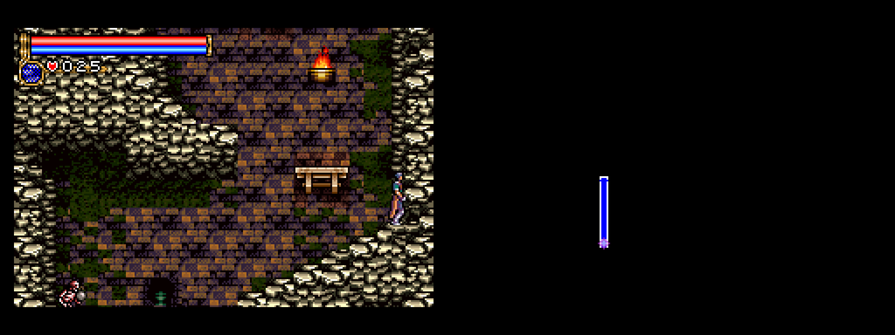
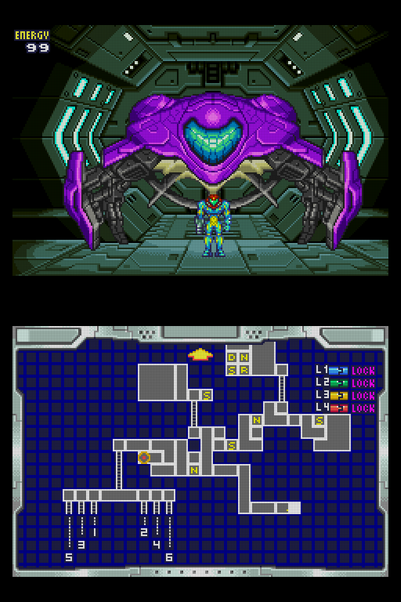
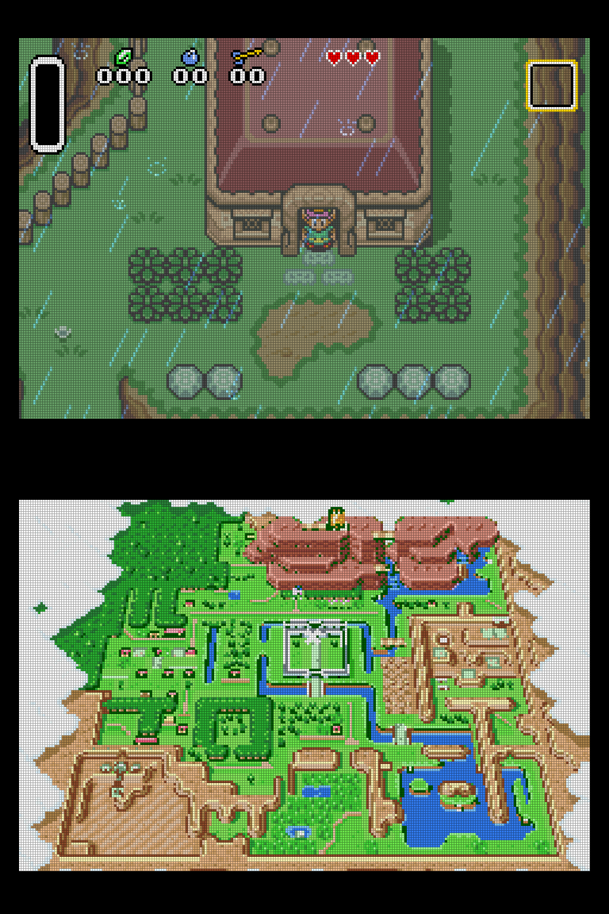

# GBA DS

A Game Boy Advance emulator for dual-screen handhelds (built for the Anbernic RG DS Plus, on ROCKNIX and on Android with GammaOS). The game runs on one screen, and the game's own map stays up on the other screen and keeps itself current as you explore, the way the DS Castlevanias work.

The idea here is "what if the Game Boy Advance had a second screen" -- part of what this means is that, at least for now, neither screen is treated like a touchscreen. Instead the secondary screen is used similarly to how the DS Castlevania games use it -- displaying maps or other secondary information to make the gameplay experience a little more pleasant on a device with the space to accommodate it. (This whole project was inspired by playing through all the DS Castlevania games and then feeling a little sad about the prospect of going back in time to the GBA games...)

<p>



</p>

<sub>Stacked screens, pixel-perfect scaling, LCD grid on.</sub>

| Game (USA, Europe and Japan) | Map button | Status |
|---|---|---|
| Castlevania: Aria of Sorrow | Select | working |
| Castlevania: Harmony of Dissonance | Select | working |
| Castlevania: Circle of the Moon | Select | working |
| Metroid: Zero Mission | Start | working |
| Metroid Fusion | Start | working |
| The Legend of Zelda: A Link to the Past | L | working |
| Tony Hawk's Pro Skater 2 (incl. SK8, Japan) | — | working: the goal sheet for the current run on the second screen; optional four-button layout |

The European and Japanese releases are supported as well as the USA ones: map, logo and border. (The European Metroids' label erasing was checked in English and German.) Any other GBA game also runs; it just gets no map screen.

**Metroid mini-map:** with the full map always up, the small 3×3 mini-map in the top-right corner of the Metroid games is hidden. It's left out when the picture is drawn, so the game itself is unchanged; set `map = 0` and it comes back along with the normal one-screen view.

**Metroid map screens:** the second screen shows the pause screen's map in its frame, tidied up: the button labels and area name are erased, the scroll arrows and play-time clock are left out, Fusion's "A OBJECTIVE" prompt and its row of ticked item icons are left out, and Zero Mission's corner minimap gives way to the map underneath, with its "SELECT / CHANGE AREAS" prompt covered by a piece of the bezel. `map_crop = 0` shows the pause screen exactly as the game draws it.

**A Link to the Past:** the cartridge also holds Four Swords, which needs linked GBAs, so the game list shows only A Link to the Past and maps are only captured while it's being played. L brings up the world map outdoors (GBA DS shows the zoomed-out whole-world view, which doesn't scroll with Link) and the dungeon map once you have it; where L does nothing (houses, caves, dungeons without their map), the last map stays up, dimmed. After Save and Quit, the second screen goes back to the logo.

## How it works

Emulation is [libmgba](https://mgba.io). GBA DS runs a second, silent copy of the emulator next to the real one. About every 1.5 seconds (adjustable: **Map Refresh** in the pause menu), and right after each room transition (detected as a fade to black), it does the following:

1. It copies the live game's state into the silent copy. The game you're playing is never paused or touched.
2. It presses the map button there, waits for the map screen to appear and settle, then records a short loop of frames so the blinking or pulsing player marker still animates.
3. It checks the result two ways before showing it: a memory flag that is set only while the map screen is open, and fixed pixels of the map screen's frame or background. Title screens, cutscenes, menus, and fades are rejected, and the previous map stays up.

You see the real in-game map with every detail the game draws (explored rooms, save and warp rooms, completion %, area names) at 4× integer scale. Circle of the Moon's map screen has no completion rate, so GBA DS copies the percentage shown after "RATE" on the game's pause screen onto the map, in the top-right corner, which stays clear of rooms even on a fully explored castle (the bottom-right corner is the fallback).

## Install on ROCKNIX

Works on stock [ROCKNIX](https://rocknix.org) and on ROCKNIXDS. On stock ROCKNIX the bottom screen is normally switched off; GBA DS switches it on while it runs (and lines up the touchscreen with it), and puts things back when it closes. See `screens.sh` in the `gba-ds` folder.

1. Download the latest `gba-ds-v…-rocknix-aarch64.zip` from the [Releases page](https://github.com/kyannon/gba-ds/releases) and unzip it into `/storage/roms/ports/`. You'll get a `gba-ds/` folder and a **GBA DS** entry.
2. Keep your ROMs in `/storage/roms/gba/` (subfolders are fine): `.gba`, or zipped as `.zip` or `.7z` (the first GBA ROM in the archive is used). Saves and states are named after the file, so `Game.zip` and an unzipped `Game.gba` share them.
3. In EmulationStation, update the game lists and launch **GBA DS** from Ports.
4. Optional: the zip also puts an icon at `/storage/roms/ports/images/GBA DS.png`. To show it, select **GBA DS** in Ports, open the game options (usually **SELECT**), choose **Edit this game's metadata**, and set **Image** to that file.

The app opens on a game list: two columns of tiles on the touchscreen, each showing the game's own logo. Tap a tile to play, or move with the D-pad (L/R jump a screenful) and press A.
- The list is rebuilt from the ROM folder every time it opens, so games you add or remove show up with nothing to re-run.
- Only games with map support are listed. Set `show_all = 1` to list every GBA ROM; games without map support play normally on one screen.
- Game names leave out tags like `(USA)` and `(En,Fr,De)`; a flag marks regional copies when you have more than one. Set `name_tags = 1` to keep the tags.
- The top screen shows the game's logo, or where it will resume once you've played it.
- The first time the list opens, each game's logo and map border art are pulled out of the ROMs in the background (about a minute on the RG DS Plus); tiles say "Loading thumbnail..." until their logo is ready. If you pick a game before that's done, a "Preparing games" screen waits for it, so the game doesn't start with crackling audio. This only happens once; the results are kept in `gba-ds/states/`.

### Launching games from EmulationStation

GBA DS can also be one of the emulators for the **Game Boy Advance** system in EmulationStation, so you can start a game from there instead of opening GBA DS first. In the game list, tap **Settings** (top right) or press **SELECT**, and switch **GBA DS in EmulationStation** on. Then restart EmulationStation (Start → Quit → Restart EmulationStation), and pick GBA DS:
- for one game: select it, open its game options (usually **SELECT**), **Advanced game options** → **Emulator** → GBADS;
- for every GBA game: in the Game Boy Advance system's advanced settings, set the emulator to GBADS.

Closing GBA DS goes straight back to EmulationStation. Your other GBA emulators work as before.

How it works: the setting writes two files into `/storage/.config/emulationstation/` (`es_config_dir` changes the folder). `es_systems_gbads.cfg`, which EmulationStation merges into its system list, copies the GBA system's emulator list with GBA DS added and points the GBA launch command at `gbads-launch.sh`. That script starts GBA DS when it's the chosen emulator, run by ROCKNIX's launcher as a Port (so your settings for Ports apply). Every other launch goes to `/usr/bin/runemu.sh` exactly as before. GBA DS rewrites the copied list each time it starts, so it keeps up with ROCKNIX updates. Switching the setting off deletes both files. If you delete the GBA DS folder without switching it off first, games set to GBA DS fall back to mGBA; delete the two files to tidy up.

**Upgrading from gbadual** (this app's old name): unzip as above, then launch **GBA DS** once. On that first run it copies your save states, resume points, menu settings and any custom logos or overlays from the old `gbadual/` folder. After that, delete the old `gbadual/` folder and the **GBA Dual Screen** entry (`GBA Dual Screen.sh`) from `/storage/roms/ports/`. If you had edited `gbadual.cfg`, copy your changes into `gba-ds/gba-ds.cfg`; battery saves (`.sav`) stay next to your ROMs and aren't affected.

## Install on Android

Made for the RG DS Plus on GammaOS (Android 14); it needs a device whose second screen Android shows as a second display.

1. Download the latest `gba-ds-v…-android.apk` from the [Releases page](https://github.com/kyannon/gba-ds/releases) and install it (allow installing from your file manager or browser when Android asks). Updates install over it and keep everything.
2. Open **GBA DS**. The first time, it asks for **All files access**: switch it on and go back. It needs it to read your ROM folder and to keep its files where you can reach them.
3. Keep your ROMs in `ROMs/gba` on the internal storage, or pick another folder in the game list's **Settings** (tap it, or press **SELECT**) → **ROM Folder**.

The game plays on the top screen; the map or logo, the pause menu and the game list are on the bottom touchscreen. Android keeps HOME for itself, so **SELECT + START** (pressed together) or **BACK** opens the pause menu. Leaving GBA DS for the home screen or another app saves the game's resume point (Android may close apps in the background). *Experimental:* coming back, the game should be paused with the menu open; this hasn't been tested on a device yet (GammaOS on the RG DS Plus doesn't switch between apps reliably).

Everything except the battery saves (`.sav`, next to the ROMs) is in the `GBA DS` folder on the internal storage: `states/`, `cheats/` (RetroArch `.cht` files), `overlays/`, `logos/`, `screenshots/` and `gba-ds.log`. Settings from `gba-ds.cfg` can go in `GBA DS/gba-ds.cfg`.

**Starting games from a frontend** (*experimental*: not yet tested on a device; reports welcome). GBA DS plays a game it's given straight away, without the game list; closing it goes back to the frontend. Starting another game from the frontend while GBA DS is open saves the current one and switches.
- **ES-DE**: add GBA DS to your custom systems. In `es_find_rules.xml`:
  ```xml
  <emulator name="GBA-DS">
      <rule type="androidpackage">
          <entry>io.github.kyannon.gbads/.LauncherActivity</entry>
      </rule>
  </emulator>
  ```
  and in the `gba` system of `es_systems.xml`:
  ```xml
  <command label="GBA DS (Standalone)">%EMULATOR_GBA-DS% %ACTIVITY_CLEAR_TASK% %ACTIVITY_CLEAR_TOP% %DATA%=%ROMSAF%</command>
  ```
- **Daijisho** (or other frontends): package `io.github.kyannon.gbads`, activity `.LauncherActivity`, with `-a android.intent.action.VIEW -d {file.uri}`, or the file path in an extra: `-e rom {file.path}`.

## Playing

- **Resume:** leaving a game saves its state automatically, and launching it again picks up exactly there. Turn this off with `auto_resume = 0`. Battery saves are written as usual too, so in-game saves are never at risk.
- **Pause menu:** tap the touchscreen or press **HOME**. Both screens dim, the game and its sound pause, and the menu appears on the touchscreen. It has two pages. Switch between them with **L1/R1** or by tapping the tabs at the top.
  - **Game:** Resume · Restart game (tap twice; unsaved progress is lost) · Save state · Load state (greyed out until you've saved one) · Cheats (see below) · Take screenshot (both screens as they look right now, with your display settings, stacked top to bottom into one PNG in `/storage/roms/screenshots`; `screenshot_dir` changes the folder) · Close game (back to the game list) · Close GBA DS (back to EmulationStation). Both save a resume point first.
  - **Display:** Swap screens · Scale (pixel perfect / full width / zoom: fills the height, cutting off the left and right edges / stretch: fills the whole screen) · LCD grid · Overlays (primary / secondary / both / none) · Map animations (off shows a still map, without the blinking markers) · Map refresh (every 3 / 1.5 / 1 / 0.5 seconds; shorter is more up to date but works the CPU harder, so try it on your device) · Show FPS (frames per second and % of full speed).

  Display choices are remembered for next time. The menu works by touch or with the D-pad and A; B, Start or HOME closes it.

### RetroAchievements

GBA DS earns [RetroAchievements](https://retroachievements.org) in **casual (softcore) mode**, with the account signed in in EmulationStation's RetroAchievements settings: when RetroAchievements is switched on there, GBA DS signs in at launch, and each game shows its achievement progress on the second screen as it starts. Unlocks pop up there too, with the badge and points, and don't cover the game.

- Hardcore mode isn't supported yet (RetroAchievements requires an emulator to be public for six months first): with hardcore switched on in EmulationStation, GBA DS still plays in casual mode.
- Save states keep the achievements' progress beside them (`<state>.ra`), so loading a state doesn't unlock anything by mistake. Cheats are allowed in casual mode.
- Offline, the game plays as normal; unlocks earned while the connection drops are sent once it's back.
- `retroachievements = 0` in `gba-ds.cfg` turns it off; `ra_username` and `ra_password` use another account than EmulationStation's. After the first sign-in GBA DS keeps a login token in `states/ra/login.cfg` instead of sending the password each time, and badges are cached in `states/ra/badges/`.
- Not in the Android version yet.

### Cheats

GBA DS reads RetroArch's cheat files (`.cht`, the format of the [libretro cheat database](https://github.com/libretro/libretro-database/tree/master/cht/Nintendo%20-%20Game%20Boy%20Advance)) from RetroArch's cheats folder, `/config/retroarch/cheats` (and `/storage/.config/retroarch/cheats`), including subfolders such as `Nintendo - Game Boy Advance/`. Set `cheat_dir` in `gba-ds.cfg` to look elsewhere (several folders separated by `:`).

- A file is picked by name: `Metroid Fusion (World) (Code Breaker).cht` goes with `Metroid Fusion (USA).gba`. The part in brackets doesn't have to match, except the region: a file marked `(USA)` isn't offered for a Japanese ROM. The Japanese Aria of Sorrow, Harmony of Dissonance and Metroid Fusion keep their data at different addresses from the other releases, so for those only files that say `(Japan)` are used, not `(World)` ones.
- **Cheats** on the Game page lists them with an On/Off switch each: D-pad and A, L1/R1 a page at a time, B to go back; or tap a cheat to switch it, and drag to scroll. A long name is shown in full at the bottom.
- Code Breaker files usually start with an "Enable Code (Must Be On)" cheat: switch that on along with the others, as on the real device.
- Choices take effect immediately and are remembered per game (`gba-ds/states/<game>.cheats`); the files' own `cheatN_enable` values are used until you change something.
- **Android:** put the `.cht` files in the `GBA DS/cheats` folder on the internal storage (subfolders are fine). GBA DS makes the folder the first time it starts.
- Cheats can crash or soft-lock a game, and anything they change is kept in your saves. Make a save state first.

### Buttons

| Button | Action |
|---|---|
| D-pad / left stick | D-pad |
| Right face button | GBA A (`ab_swap = 1` flips A/B) |
| Bottom face button | GBA B |
| L1 / R1 | GBA L / R |
| Start / Select | Start / Select |
| HOME, or tap the touchscreen | Pause menu (Android: SELECT + START, or BACK) |
| L2 | Swap screens |
| R2 (hold) | Fast-forward |
| HOME + R1 / L1 | Quick save / load state |
| HOME + Start | Quit |
| HOME + X | FPS counter (also in the menu) |

**Four-button layout (Tony Hawk's Pro Skater 2).** The GBA version uses L and R for two of the console games' four face buttons. Tap a layout under **Controls** at the bottom of the second screen (it's touch only, and it's there when the second screen is the touchscreen):

- **GBA**: the layout above.
- **Four buttons**: like the console games. Top = GBA A (grind), bottom = GBA B (ollie), left = GBA L (flip), right = GBA R (grab). L1 / R1 still work as L / R.
- **Auto**: four buttons while you're skating, the GBA layout everywhere else (menus, pause, goal sheets, results), so A and B confirm and go back as the game expects. The tile for the layout in use right now is outlined.

The choice is remembered per game.

### Library

| Input | Action |
|---|---|
| D-pad, L/R | Move, page up/down |
| A / Start, or tap a game | Play |
| Drag | Scroll the list |
| B, HOME, or QUIT | Back to EmulationStation |
| SELECT, or tap Settings | Settings (GBA DS in EmulationStation) |
| X, or tap the button left of Settings | Switch between the list of names and the grid of logos (remembered) |

### Where files go

| File | Location |
|---|---|
| Battery saves | `Game.sav`, next to the ROM. On first launch an existing RetroArch `Game.srm` is copied to `Game.sav`; the `.srm` is left alone. |
| Save states, resume points, library thumbnails | `/storage/roms/ports/gba-ds/states/` |

**Android** (in development): everything except the battery saves is in the `GBA DS` folder on the internal storage, laid out like the ROCKNIX install folder: `states/` (save states, resume points, menu settings), `cheats/`, `overlays/`, `logos/` (your own logo images), `screenshots/` and `gba-ds.log`. This needs the "All files access" GBA DS asks for on its first start; without it, they're kept in the app's own folder (`Android/data/io.github.kyannon.gbads/files`), which other apps can't open.

Until the first map is ready (title screen, intro, a fresh boot), the map screen shows the game's logo. No logo files are shipped: the first time a game appears in the list, GBA DS boots it silently in the background, runs it to its title screen, and renders just the background layer that holds the logo. It saves that as `gba-ds/states/logos/<CODE>.png`, at the game's own resolution with transparency, and draws it at sharp whole-number scale. To use your own art instead, put `<CODE>.png` (or `.bmp`) in `gba-ds/logos/`.

## Map screen surrounds and overlays

The **Overlays** setting (Display page of the menu, or `overlays` in `gba-ds.cfg`) cycles **PRIMARY / SECONDARY / BOTH / NONE**. "Primary" is the game screen and "secondary" the map screen, whichever physical screen they're on: swap screens and each overlay moves with its picture.

**Secondary** turns on the generated map surround and your map-screen overlay. The surround fills the space around the map with graphics from each game itself. Nothing is shipped: like the logos, it's extracted from the ROM once in the background and cached in `gba-ds/states/frames/`.
- **Castlevania (all three):** the map's background colour, plus the border from the game's own menus:
  - Aria of Sorrow and Harmony of Dissonance use their name-entry frame.
  - Circle of the Moon uses the bevelled boxes from its file menu.

  In pixel-perfect mode the border goes all the way round the map. In full-width mode it spans the top and bottom.
- **Metroid: Zero Mission / Fusion, A Link to the Past:** none. These map screens are shown whole, with the game's own frame, so there's nothing to fill.

The surround is assembled in the game's own pixel space and scaled together with the map, so it lines up exactly and the LCD grid covers it too.

### Your own overlays

Put PNGs in `gba-ds/overlays/`. Each is 1024×768 and is drawn over the whole screen, so leave it transparent where the picture should show. The primary (game screen) overlay is a good place for a console bezel. For each screen the first file found is used, so a game's own overlay beats a global one:

| | Primary (game screen) | Secondary (map screen) |
|---|---|---|
| this game, this scaling | `<CODE>-primary-<scale>.png` | `<CODE>-secondary-<scale>.png` |
| this game | `<CODE>-primary.png` | `<CODE>-secondary.png` |
| every game, this scaling | `primary-<scale>.png` | `secondary-<scale>.png` |
| every game | `primary.png` | `secondary.png` |

- `<CODE>` is the game code: `A2CE` Aria of Sorrow, `AAME` Circle of the Moon, `ACHE` Harmony of Dissonance, `BMXE` Zero Mission, `AMTE` Fusion, `AZLE` A Link to the Past.
- `<scale>` is that screen's scaling: `integer` (pixel perfect), `fit` (full width), `zoom` or `stretch`.
- Map overlays named the old way (`<CODE>-<scale>.png`, `<CODE>.png`) still work, ahead of the global ones.
- The secondary overlay is only drawn while a map is showing, not over the logo screen.

Areas to keep clear (the same for every game, since all maps are now shown at full GBA size):

| Screen | integer | fit |
|---|---|---|
| game or map | x=32, y=64, 960×640 | x=0, y=43, 1024×682 |

`border_color` (hex, default `000000`) sets the colour behind the map where there's no overlay. 

## Settings

Settings live in `gba-ds.cfg` next to the binary. The file is commented. The options you're most likely to change:

- `rom_dir`: folders to list. Separate several with `:`.
- `swap = 1`: map on the other screen. Swapping from the menu or with L2 is saved to `states/prefs.cfg` and wins over this setting.
- `touch_screen`: `first` or `second`, whichever screen has the touch panel. The menu and game list are drawn there.
- `touch_map`: try `touch_map = screen` if taps land in the wrong place.
- `home_button`: use this if HOME doesn't open the menu.
  1. Start once with `GBADS_DEBUG=1` in `launch.sh`.
  2. Press HOME.
  3. Put the button number the log shows into `home_button`.
- `menu_combo = select+start`: SELECT and START pressed together also open the menu (the game doesn't see the pair; either button alone still goes to the game).
- `layout`:
  - `auto` is the default. On ROCKNIX's sway setup, GBA DS asks sway to make its window full screen across both 1024×768 outputs and splits the window in half.
  - `dual` uses one window per display.
  - `single` uses one screen, and L2 flips between game and map.
- `scale` / `map_scale`, `lcd_grid`, `lcd_strength`: the display options from the pause menu, plus `scale = stretch` and grid darkness. Full width keeps pixels sharp: the image is scaled up by a whole number on the GPU, then filtered down to the final size. The LCD grid is drawn over that same image, so it costs essentially no CPU.
- `map_crop`: on by default. It tidies the Metroid map screens. Set it to 0 to show the pause screen exactly as the game draws it.
  - Zero Mission keeps its whole pause screen, frame included, and only the lettering is erased: the L and R key letters, SLEEP, the area name, STATUS, and the A on the button beside the minimap. The keys, plates and button stay; the blank plates (magenta) and L/R keys (orange) are recoloured to the dark grey-green of the curved pieces beside the area name so they don't stand out.
  - Fusion also keeps its whole pause screen. The L and R key letters, SLEEP, the area name and STATUS are erased, and the plates (which cycle through four colours) are recoloured to the frame's greys. The "A OBJECTIVE" prompt is removed and the map grid behind it rebuilt, inside two small boxes around the button and the word.
- `map_interval`: frames (60 a second) between periodic map refreshes (default 90, every 1.5 s; the pause menu's Map Refresh sets 180, 90, 60 or 30). The map also refreshes after every room transition. Each refresh runs the hidden copy of the game for a moment, so very short intervals can make the sound crackle on a slower device; the log reports it.

Logs go to `/storage/roms/ports/gba-ds/gba-ds.log`. If the sound ever crackles, the log says so: every 5 seconds with a problem it reports audio underruns, slow frames and how busy the background map capture was. With `GBADS_DEBUG=1`, the log also records every button, key and touch.

## Building

On an x86_64 Linux host with git, cmake, make, and zip, run:

```sh
scripts/build-rocknix.sh            # -> dist/gba-ds-v<VERSION>-rocknix-aarch64.zip
```

The script fetches a GCC aarch64 toolchain, mGBA (pinned commit), and SDL2 into `deps/`.

To build for the host so you can develop and test (needs libpng-dev too):

```sh
scripts/setup-host.sh   # first time: mGBA and SDL2 into deps/, then builds
make && make tools      # afterwards: build/host/gba-ds, build/host/harness
```

Run it headless and drive it from a script (button combos, `HOME`, `TAP:x,y`, `SHOT:file.bmp`, `QUIT`; see `--help`):

```sh
SDL_VIDEODRIVER=offscreen SDL_AUDIODRIVER=dummy GBADS_WINDOW=640x960 \
  build/host/gba-ds --rom-dir=roms --state-dir=/tmp/st --input-script=test.txt
```

## Adding a game

Each supported game is one entry in `src/profiles.c`:

- the button press that opens the map
- the map's crop rectangle
- a few pixels that are always the same colour while the map is up
- a memory flag that is set only while the map screen is open
- an optional flag for "in gameplay" on the live core

The tools in `tools/` are for finding these values:

- **`harness`**: runs a ROM headless from a small script. Script commands: `tap A`, `hold RIGHT 60`, `shot name`, `save`/`load` states, `dumpram name`, `map name` (runs the real capture code).
- **`ramdiff.py`**: given RAM dumps taken with the map open and closed, lists the addresses that cleanly separate them.
- **`sheet.py`**: tiles screenshots into a contact sheet.

## Roadmap

- RetroAchievements: hardcore mode (once allowed), an achievement list in the pause menu, Android
- HUD elements as well as maps on the second screen
- More games!

## AI Disclosure

Claude is doing the lion's share of coding here. I am testing each iteration on real hardware before moving it into a release.

## Licence

GBA DS statically links libmgba, which is © Jeffrey Pfau and licensed under MPL-2.0. The mGBA source is at <https://github.com/mgba-emu/mgba> (pinned commit in `scripts/build-rocknix.sh`).

The interface text is set in [Jost](https://github.com/indestructible-type/Jost) (© The Jost Project Authors), bundled under the SIL Open Font License 1.1 (`assets/fonts/Jost-OFL.txt`), and drawn with [stb_truetype](https://github.com/nothings/stb) (public domain).

RetroAchievements support uses [rcheevos](https://github.com/RetroAchievements/rcheevos) (© RetroAchievements, MIT licence), vendored in `third_party/rcheevos`.
